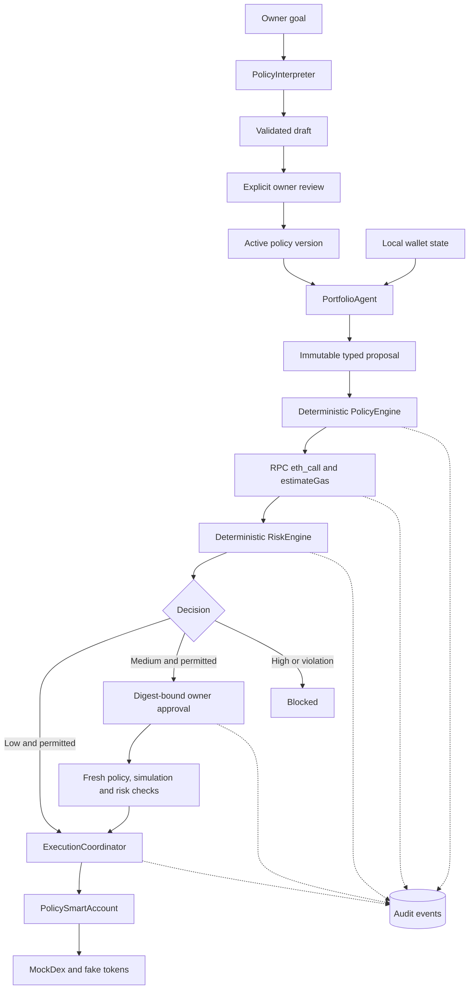
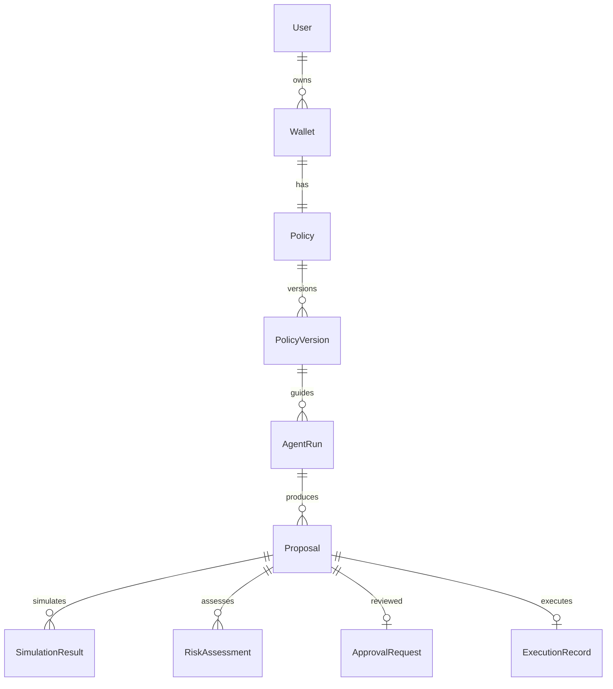
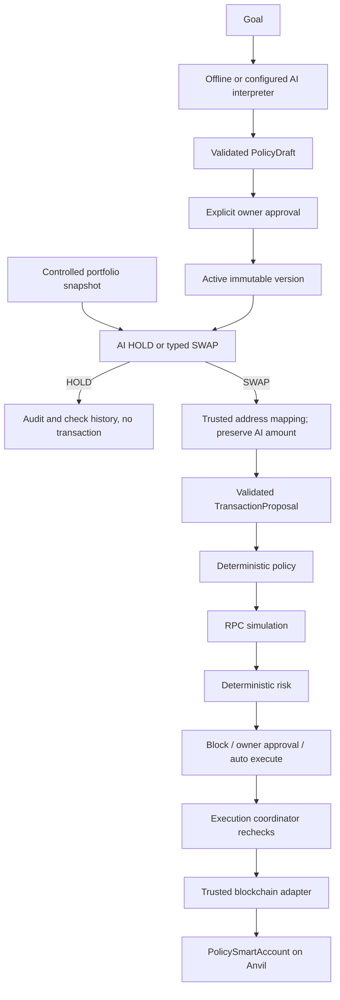
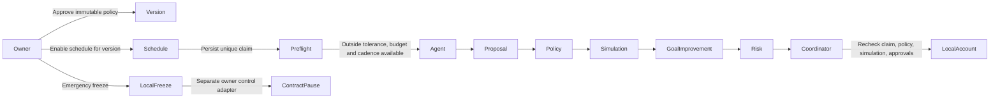

# Architecture

This is a modular monolith with one synchronous execution coordinator. PostgreSQL owns application state; Anvil owns token balances, replay protection and the independent daily ceiling. Browser wallet integration is intentionally absent: the app never asks to connect a real wallet.

## Dependency direction

`schemas` has no infrastructure dependencies. `policies/rules` depends only on domain schemas, never the interpreter or blockchain. `risk` is deterministic and has no LLM dependency. `agent` returns proposals and cannot import execution. `simulation` consumes the adapter interface. `execution` composes these components and is the only application component permitted to submit proposals to the signer adapter. API routes accept goals, fixed demo modes and identifiers, never calldata.

`models` defines persistence records. `db/repository` owns lookup and wallet locking; application use cases control explicit transaction scope. Core decisions use immutable Pydantic objects, not database JSON dictionaries. JSON strings are decoded and validated at the persistence boundary. API response schemas are separate from ORM records.

## Data and concurrency

All wallet-changing decisions lock its PostgreSQL row. Before RPC submission, a separate committed transaction records execution intent and marks the wallet busy. This prevents concurrent requests and policy activation while a transaction is pending. On-chain spending is read during revalidation and is the daily accounting source. Pending submissions freeze further proposals instead of permitting optimistic spending.

The chain operation ID is the hash of the complete immutable proposal, including policy version and creation time. Both contract and database reject repeated execution. A granted approval is valid for ten minutes and binds the exact proposal hash; policy activation invalidates old proposal approvals. Execution repeats policy, simulation and risk checks after approval.

PostgreSQL and EVM cannot commit atomically. A submission timeout leaves the wallet frozen. A known transaction hash can be reconciled with `POST /proposals/{id}/reconcile`. A crash before a hash is durably stored requires operator investigation of `Executed` events and the proposal digest. There is no automatic unlock or blind retry. This availability tradeoff deliberately preserves safety.

## Account decision

`SmartAccountAdapter` isolates the educational wallet. ERC-4337 would introduce bundlers, paymasters and additional trust assumptions without improving the first demonstration. Future adapters must preserve the same typed operation and simulation boundaries.

Only the immutable owner may change the agent, allowed targets, pause or limit. The account does not expose arbitrary calldata or persistent unlimited allowance. Input tokens are immutable; exact approvals are cleared after a swap; output balance changes are checked. The owner contract settings cap backend permissions but do not fully reproduce portfolio targets or cadence.

## Local assumptions

TestUSDC and TestWETH both use six decimals and trade at 1:1. Expected token changes are derived from this fixed mock behavior after a successful EVM simulation, not general-purpose token tracing. Chain timestamp determines UTC daily spending windows. The owner can request a run or explicitly enable version-bound local scheduling (described below). Public networks, including Sepolia, are unsupported and rejected.

Reference APIs: [SQLAlchemy transaction scope](https://docs.sqlalchemy.org/en/20/orm/session_basics.html), [web3.py contract calls](https://web3py.readthedocs.io/en/v7.5.0/web3.contract.html), and [Foundry](https://www.getfoundry.sh/).

## Optional AI interpretation and trade proposals

`OpenAIResponsesProvider` and `OllamaProvider` implement infrastructure-free `StructuredProvider`. The live factory selects `ProviderPolicyInterpreter` and `AITradingAgent`; offline uses `LocalPolicyInterpreter` and `PortfolioAgent`. The model returns address-free `ProposalIntent` with HOLD or SWAP, assets, integer amount, slippage and reason. `AITradingAgent` maps accepted output to typed domain objects without altering amounts. Deployment supplies addresses and operation; the model receives no signer or tools. `agent/sizing.py` remains the offline reference and readiness helper. Provider errors fail closed, never falling back to execution.

Provider errors never trigger a fallback action. Explicit demo scenarios stay fixture-generated even in OpenAI mode. Source metadata is preserved in audit events and displayed with each proposal independently of the current mode. No migration or contract change is needed.

## Owner-enabled scheduling and freeze

A single FastAPI lifespan worker polls durable schedules every five seconds. Per-wallet PostgreSQL locks and unique check identities prevent overlapping generation and stale execution. Agent generation reserves the wallet in a short transaction, then calls the provider outside database locks so emergency freeze remains responsive. Completion checks the reservation, active version and schedule identity. The coordinator checks schedule authorization under the same wallet lock as its durable submission intent. Freeze invalidates claims and cancels unsubmitted proposals; an old completion cannot overwrite a newly enabled schedule. No worker automatically replays an interrupted in-progress claim or ambiguous transaction submission.

Owner controls are a separate narrow interface from the agent execution adapter. The local owner adapter calls only `setPaused` using Anvil's disposable unlocked owner identity. Local freeze commits before the emergency owner RPC call so RPC failure cannot restore execution. Three consecutive generation/validation failures or an unresolved submission trip the circuit breaker. State-read failures count toward the breaker too. Resume requires explicit owner authentication and no unresolved wallet reservation; scheduling remains off.

## Check history projection

Immutable `AGENT_ACTIVITY` audit snapshots describe a check's observation, accepted
AI decision, proposed trade and linked proposal. They reuse the audit table rather
than add a competing execution state machine. The API reads the latest snapshot
per check and resolves current proposal status from the authoritative proposal
record. Audit/UI balances are decimal integer strings so large EVM balances round
trip without JavaScript precision loss. Failures store fixed safe messages, not raw
provider responses. Model calls remain outside wallet locks; final claim/version/
freeze checks still precede proposal routing and submission.
